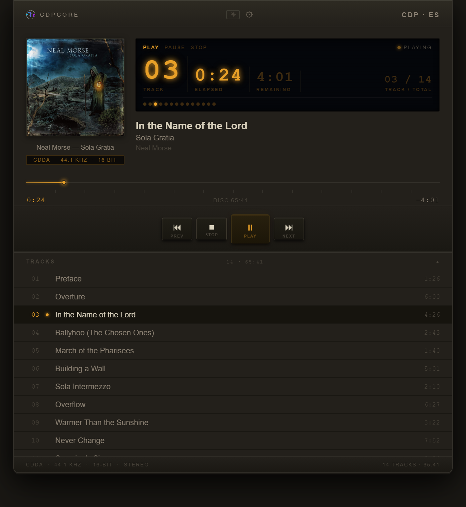
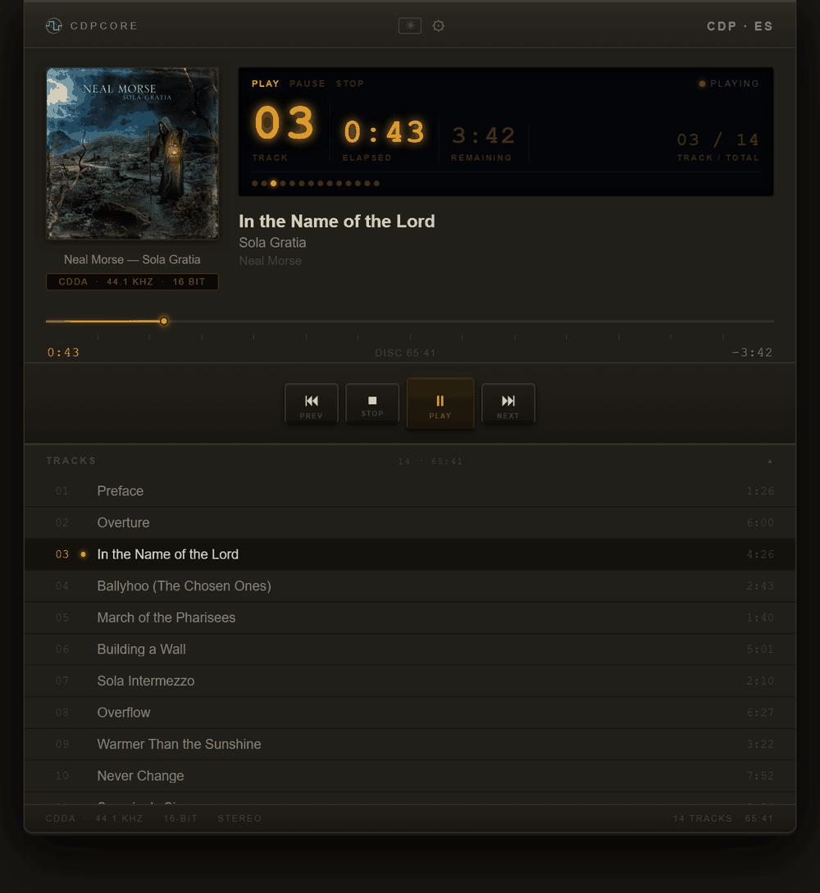
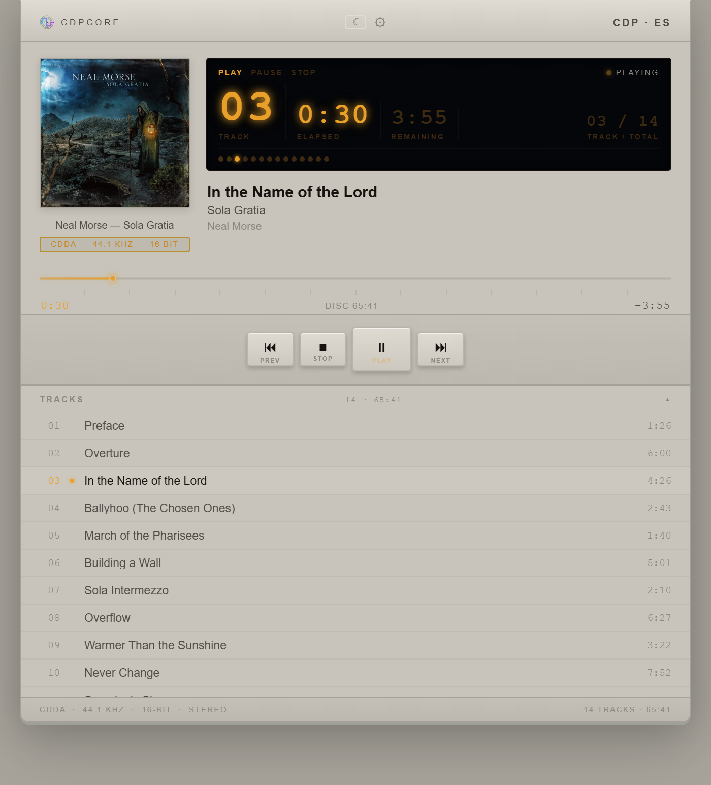
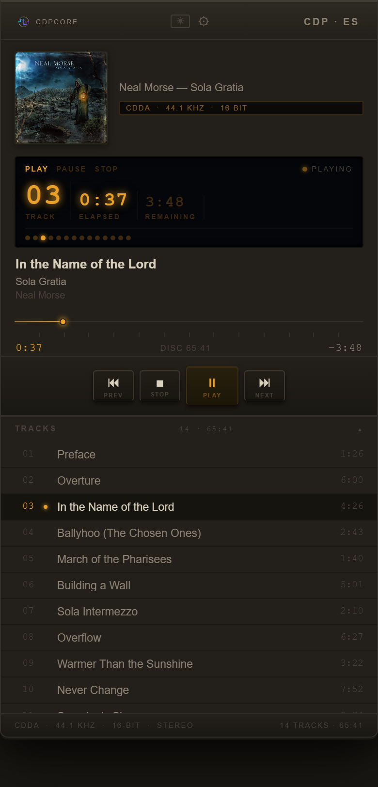

<p align="center">
  <picture>
    <source media="(prefers-color-scheme: dark)" srcset="assets/brand/logo-primary.svg">
    
  </picture>
</p>

<p align="center"><b>Dedicated CD playback appliance for Raspberry Pi.</b></p>

<p align="center"><i>A CD player with network-based control, designed for bit-perfect playback and full control over the audio pipeline.</i></p>



Audio flows directly from the CD drive to the DAC:

CD drive -> **CDPcore reader** -> **mpv (raw PCM)** -> ALSA -> USB DAC (USB Audio Class compliant DAC)

Healthy audio stays bit-perfect: s16le, 44.1 kHz, stereo, with no resampling.
Damaged samples receive bounded CD-player concealment. No network audio transport or audio middleware.

A web UI (served by the backend) provides full playback control from any browser on the local network.

A Roon extension pauses the active zone when the CD starts playing and can
optionally resume it when playback stops or the disc is ejected, all configurable
per-session in the Roon Settings -> Extensions panel.

```
CD Drive (/dev/cdrom)
   |
   v CDPcore CDDA reader (SG_IO READ CD, optional C2 pointers)
   |
   v mpv (raw PCM stdin, s16le 44100 Hz stereo)
      IPC: /var/cache/cd-player/mpv.sock
   |
   v ALSA  hw:N,0 (auto-detected)
      USB DAC (USB Audio Class compliant)

Python FastAPI  (0.0.0.0:8000)
   |- Serves web UI  (GET /)
   |- REST API  (playback commands + status)
   |- WebSocket /ws  (pushes state to all connected browsers)
   |- _disc_monitor  (asyncio task - polls disc, stall watchdog)
   `- /cd/inserted · /cd/ejected  (optional udev webhooks)

libdiscid  -->  MusicBrainz API  -->  Cover Art Archive
   |               | (404)             |
   TOC        GnuDB (CDDB)        iTunes API
              album/artist/tracks  cover JPEG
                                  (cached in /var/cache/cd-player/)

Browser  <--  WebSocket ws://cdpcore.local:8000/ws  (state push, ~1 s)
   `- REST POST /play · /pause · /stop · /next · /prev · /eject

CDPcore Roon Extension <--> Roon Core (mDNS)
   `- polls backend /status every 1 s -> pauses / resumes Roon zone

avahi-daemon  ->  cdpcore.local  (mDNS hostname + HTTP service announcement)
```

---

## Features

- Bit-perfect healthy CD playback; damaged samples receive interpolation and gap concealment
- CDDA reader -> mpv raw PCM -> ALSA -> USB DAC pipeline
- Continuous or recovery read policy; mirror or silence gap treatment
- Quiet burst reads at the drive's minimum supported speed
- Real-time Web UI (WebSocket)
- Automatic metadata + cover art lookup
- Roon integration (auto pause/resume)
- Automatic DAC detection on plug/unplug (udev + reconciliation, no manual rescan)
- First-boot setup for admin posture (PIN-protected or explicit LAN-Trust)
- Appliance-management pages separated from the listening surface
- Zero audio middleware (no PulseAudio / PipeWire)

---

## Technology Stack

| Layer | Technology |
|-------|-----------|
| CD playback | CDPcore SG_IO READ CD source -> **mpv** raw PCM stdin |
| Playback control | mpv IPC socket (`/var/cache/cd-player/mpv.sock`) |
| Backend | **Python 3**, **FastAPI**, **uvicorn** (asyncio) |
| Disc ID / TOC | **libdiscid** (`python-discid`), cdparanoia fallback |
| Metadata (primary) | **MusicBrainz** (`musicbrainzngs`) |
| Metadata (fallback) | **GnuDB** (CDDB protocol, `httpx`) |
| Cover art (primary) | **Cover Art Archive** (via MusicBrainz release ID) |
| Cover art (fallback) | **iTunes Search API** (free, no key required) |
| ALSA enumeration | `/proc/asound/cards` + `aplay -l` fallback |
| Real-time UI updates | **WebSocket** (`/ws`, FastAPI native, server-push) |
| Service discovery | **avahi-daemon** (mDNS, `cdpcore.local`) |
| Web UI | Single-file HTML/CSS/JS served at `/` (no framework) |
| Extension | **Node.js**, `node-roon-api` |

---

## How It Works

### Disc detection

A background asyncio task identifies new discs through libdiscid. Once a disc
is known, it polls media presence with CDROM_DRIVE_STATUS every 3 s during
playback and every 0.5 s while stopped. It pauses these polls during a cold
segment start. Disc-ID reads stay outside playback so they do not compete
with the CDDA reader.

The reader distinguishes sense-classified media errors from kernel-aborted
commands. Two consecutive kernel timeouts, or a segment start with no PCM
and no sense-classified failure within 15 s, report DRIVE ERROR. Media-error
recovery can wait in recovery mode without being mistaken for a stalled drive.

This handles four scenarios without relying on udev:

- **Service started with disc already in drive** - detected within 7 s of startup
- **Disc inserted while running** - detected within 5 s of insertion
- **Disc swapped** - old playback stopped, new metadata loaded automatically
- **Disc ejected during playback** - ioctl detects removal immediately; state resets and music stops in under 1 s

The disc is read **once per load** via `read_disc_full()`, which returns the
MusicBrainz disc ID, the full TOC, and the FreeDB/CDDB fingerprint in a single
pass - avoiding multiple physical disc reads during metadata loading.

The REST endpoints `/cd/inserted` and `/cd/ejected` still accept udev webhook
calls but are secondary to the polling mechanism.

### Quiet play - the drive's minimum read speed

On every disc insertion CDPcore asks the drive for 1x (real-time CDDA speed)
through `CDROM_SELECT_SPEED`, from udev (`cd-setspeed.sh`) and again from the
backend when it detects the disc. mpv does not override it.

The speed a drive actually settles at is decided by its firmware: some go to
1x, many slim USB drives stay at their own minimum of about 4-5x. The backend
therefore measures the real read throughput right after the request and
shows it on the system page as **Minimum read speed** (the reference
HL-DT-ST GP30NB20 reports 4.2x). Audio is always consumed in real time, so
the drive reads in short bursts and idles between them at any speed; a lower
minimum only means less mechanical noise.

mpv uses a 1 s raw-audio cache with a 352,800-byte demuxer limit. The reader
normally keeps 2 s of lookahead, growing to 20 s when C2 pointers, slow reads
or failures warn of damage, and returning to 2 s after a clean minute.
The pipe provides pacing; the drive idles once the bounded queue fills.

Track-to-track seeks cause a brief spin-up as the laser repositions, but the
drive settles back to its operating speed within a few seconds.

### Metadata lookup

When a disc is detected, the following cascade runs until metadata is found:

1. `libdiscid` reads the TOC once - producing the MusicBrainz disc ID, track
   durations (in sectors), and the CDDB fingerprint
2. **MusicBrainz** is queried first for album, artist, track list, and release ID
3. If MusicBrainz returns a release ID, cover art is fetched from **Cover Art Archive**
   (its 1200 px thumbnail, with 500 px and the original as fallbacks; original uploads can
   be scans of 20 MB or more)
4. If MusicBrainz has no match, **GnuDB** (free CDDB server) is tried using the
   FreeDB fingerprint - it returns album, artist, and track titles (no durations)
5. Track durations for GnuDB results are filled from the TOC (sector-accurate)
6. If GnuDB resolves the disc, cover art is fetched from the **iTunes Search API**
   (free, no API key, returns up to 1000x1000 px JPEG)
7. All results are cached in `/var/cache/cd-player/` - subsequent insertions of
   the same disc are instant

### Playback (mpv IPC)

CDPcore owns the drive through SG_IO READ CD and feeds mpv raw s16le PCM at
44.1 kHz stereo through stdin. The TOC excludes data tracks. A segment starts
at the selected track and continues through the remaining audio tracks in one
PCM stream, so natural boundaries are gapless. The monitor maps mpv's stream
time-pos through that plan into track number and elapsed time. It fires
on_track_end once per natural boundary and at disc EOF. Position uses a
monotonic fallback only until time-pos becomes available.

Pause and resume use mpv's pause property. A paused player fills its bounded
pipe/lookahead and then the reader idles. Explicit track selections, Next and
Prev replace the segment and mpv process. Requests before first PCM are queued;
the latest selection wins. Stop and eject detach immediately while background
teardown waits for the current read and restores factory drive retries.

**Advanced playback** on the system page is collapsed by default and admin-gated.
Settings persist in playback.conf beside auth.conf in the backend config directory
(CDPCORE_CONFIG_DIR, default ~/.config/cdpcore-backend), taking effect at the next
segment start:

- **Continuous** (default): 8 internal drive retries; a failed chunk is walked
  frame by frame, and after a failed frame the frame four ahead is probed: if it
  fails too, the frames in between are treated as one burst, otherwise each is
  tried once. Below a 1.5 s lookahead reserve, remaining unattempted frames are
  muted so playback never pauses.
- **Recovery**: 128 retries, a group/overlap/single-frame salvage ladder,
  with frame-exact edge refinement for inferred dead bands. Playback may wait.
- **Mirror** (default): full-level reversed preceding audio fills gaps of up to
  eight frames; longer gaps become silence. **Silence** always uses digital
  silence. Both use 8 ms raised-cosine edge fades and one guard frame on each
  side of unreadable runs.
- C2-flagged samples are interpolated linearly per channel. Drives rejecting
  C2 fall back to PCM-only READ CD, showing **Not available** for C2 counters.

The system page shows active mode, frames muted and frames with C2-interpolated
samples. The listening page shows READ ERR n next to PLAYING only when this
segment has muted frames; selecting a new segment clears the count.

Development overrides: CDPCORE_READ_MODE=continuous|recovery wins over persisted
read mode. CDPCORE_CDDA_INJECT_FAIL=LBA_FROM:LBA_TO[:COST_S] injects a failing
half-open LBA range (default cost 0.3 s); it is disabled unless explicitly set.
The shipped READ CD timeout is 8000 ms. Factory retry count 128 is restored on
startup, stop, eject, reader exceptions and shutdown. Device and sysfs queue
resolution use /dev/cdrom, including after USB re-enumeration.

Existing appliances must refresh system/cdpcore-backend.service (or reinstall)
and reload systemd before saving playback settings: the unit grants a narrow
writable exception for /home/cdplayer/.config/cdpcore-backend. A custom
CDPCORE_CONFIG_DIR must likewise be writable under the service sandbox.

### State machine

```
IDLE
 |  disc detected by _disc_monitor
 v
LOADED  (loading=true while metadata lookup runs -> VFD: READING)
 |  POST /play or /play/{n}
 v
PLAYING  (buffering=true while mpv spins up -> VFD: STARTING)
 |  POST /pause
 v
PAUSED
 |  POST /stop or disc removed
 v
IDLE
```

### Web UI

The CDPcore interface is served at `http://cdpcore.local:8000/` and provides:
- VFD-style amber display (track, elapsed, remaining, track/total)
- Cover art with placeholder when unavailable
- Album / artist / track title
- Progress bar with per-track tick marks
- Transport controls (Prev, Stop, Play/Pause, Next)
- Collapsible track list with click-to-play (expanded by default)
- Light / dark mode toggle (persisted in localStorage)
- Responsive layout for mobile (<= 576 px breakpoint)
- Gear icon linking to the system management page
- Installable to the home screen as a standalone app (Samsung Internet on Android, Safari on iOS) via Add to Home Screen

<p align="center">
  
</p>
<table align="center">
  <tr>
    <td align="center" valign="top">
      <br>
      <sub>Light theme</sub>
    </td>
    <td align="center" valign="top">
      <br>
      <sub>Mobile layout</sub>
    </td>
  </tr>
</table>

The UI connects to `/ws` via WebSocket on load. The server pushes a state snapshot every second (for elapsed time) and immediately on any state change (disc insert, track advance, play/pause/stop, eject). If the WebSocket drops, the UI falls back to polling `/status` every 2 s and reconnects automatically.

### System management

A separate administrative surface at `http://cdpcore.local:8000/system` provides:

- **System** - Pi model, OS version, uptime
- **CPU** - temperature (via `vcgencmd`), load average (1 / 5 / 15 min) with visual bar
- **Memory & Storage** - RAM and disk usage with bars (used / total)
- **Network** - all interfaces with link state, IP, MAC, and link speed
- **CD Drive** - model and measured minimum read speed
- **Services** - cdpcore-backend and cdpcore-extension status and PID
- **Roon Bridge / Extension** - service status, PID, settings, and extension actions
- **Admin Settings** - admin PIN change and auth-mode change (`PIN` or explicit `LAN-Trust`)
- **Advanced playback** - read mode (continuous / recovery), gap treatment (mirror / silence) and live
  counters of concealed and C2-interpolated frames (collapsed by default)
- **Audio** - current audio device state (USB DAC / Multiple DACs / No USB DAC / Audio device missing) with the selected DAC name when applicable, updated automatically
- **Updates** - operator-initiated update checks and release updates from the latest tagged GitHub Release
- **Backend Logs** - last 150 lines of the backend service journal, with a refresh button
- **Actions** - restart backend, restart all, reboot Pi, power off Pi

Actions that terminate the backend process (restart, reboot, poweroff) execute with a short delay so the HTTP response is delivered first. All destructive actions require confirmation. The `cdplayer` service user is granted minimal sudo rights for these operations via `/etc/sudoers.d/cdpcore`.

Updates are checked only from the system management page. Pressing **Update**
starts a root-owned one-shot executor that downloads the latest tagged GitHub
Release source tarball, updates `/opt/cdpcore/backend` and
`/opt/cdpcore/extension`, installs changed dependencies, and restarts CDPcore.
Operator state lives outside `/opt/cdpcore` and is not overwritten by this flow.

Release checks and self-updates use `ccarrascoc85/cdpcore` by default. Operators
who maintain a fork can set `CDPCORE_RELEASE_REPO=<owner>/<repo>` with systemd
drop-ins for both `cdpcore-backend.service` and `cdpcore-update.service`, then
run `sudo systemctl daemon-reload` and restart the backend.

> **Roon Bridge coexistence:** CDPcore is designed to run alongside Roon Bridge on the same appliance. The system pages manage the `roonbridge.service` unit and extension behavior; the Roon extension pauses the active zone when CD playback starts and can resume it when playback stops - both systems share the same USB DAC without conflict.

### Admin PIN gate

Everything under the appliance-management surface (`/system`, `/system/network`, `/system/roon`, `/system/admin`, and their data/mutation endpoints) is protected by a 6-digit admin PIN in the default posture. Playback and status endpoints stay open on the LAN so normal listening is unaffected.

- **First-time setup.** Fresh installs open with a welcome flow at `/setup`. The operator must choose either PIN-protected admin mode or explicit LAN-Trust before the appliance is considered configured.
- **Storage.** Admin-auth state lives in `/home/cdplayer/.config/cdpcore-backend/`:
  - `admin.pin` - PBKDF2-SHA256 PIN hash material
  - `session.key` - admin-session signing key
  - `auth.conf` - persisted auth-mode override
- **Admin mode.** `POST /admin/unlock` with the PIN sets a signed `HttpOnly`, `SameSite=Strict` session cookie valid for 15 minutes. When it expires, the UI re-prompts.
- **Brute-force protection.** `/admin/unlock` enforces a per-IP failure tracker (in-process). The first three failures only carry the baseline 200 ms delay; after that the imposed delay grows exponentially up to 30 s. A successful unlock or 10 minutes of inactivity resets the counter for that IP.
- **Cross-origin defense.** `/admin/unlock` and `/admin/setup` reject browser POSTs whose `Origin` (or `Referer`, when `Origin` is absent) does not match the request's `Host`. CLI/script callers without those headers are still allowed.
- **Defensive headers.** Every response carries `X-Frame-Options: DENY`, `X-Content-Type-Options: nosniff`, `Referrer-Policy: same-origin`, and a `Content-Security-Policy` that blocks framing and locks default sources to the appliance origin (cover-art `img-src` allows third-party HTTPS).
- **Privileged surface.** `system/cdpcore-sudoers` only authorises specific verb tails (`systemctl restart cdpcore-backend`, `systemctl restart cdpcore-extension`, `systemctl start cdpcore-update`, `nmcli connection modify *`, `nmcli connection up *`, `nmcli connection delete *`, `nmcli radio wifi on/off`, `nmcli device wifi rescan`, `nmcli device wifi connect *`, `hostnamectl set-hostname *`). Backend validators in `backend/network.py` further restrict argument shapes (IPv4, RFC 1123 hostname, NetworkManager connection-name whitelist) so the wildcards cannot be abused via API input.
- **Change PIN.** On the appliance:
  ```bash
  sudo -u cdplayer /opt/cdpcore/venv/bin/python -m auth rotate
  # (run from /opt/cdpcore/backend)
  ```
  Or set a chosen PIN explicitly:
  ```bash
  sudo -u cdplayer /opt/cdpcore/venv/bin/python -m auth set 123456
  ```
  The same can be done from the Admin Settings page via `/system/admin`.
- **Mode changes.** The active admin posture is persisted in `auth.conf`. `CDPCORE_ADMIN_AUTH` remains the bootstrap/default input, but once a mode is saved the persisted value is authoritative at runtime.
- **Opt out (private installs).** LAN-Trust / auth-off remains available for private installs, either during `/setup` or later from the Admin Settings page. Community-style deployments should keep the default protected posture.

---

## Hardware

CDPcore distinguishes between hardware that has been observed working under
real test runs and hardware that the design is targeted at. Claims about a
particular board are only made where there is repeated, real-hardware
evidence.

### Hardware posture

| Tier | Board | Status |
|------|-------|--------|
| Recommended reference | **Raspberry Pi 4** | Recommended for normal users. Comfortable margin for CDDA + metadata + Roon coexistence. |
| Supported floor | **Raspberry Pi 3 Model B** | Supported for the validated configuration: USB optical drive + USB DAC + local LAN operation. |
| Untested | Raspberry Pi 5 | No formal test evidence yet. |

### Validated configurations

| Date       | Board                  | DAC          | Drive        | Result |
|------------|------------------------|--------------|--------------|--------|
| 2026-04-22 | Raspberry Pi 3 Model B | Topping E50  | LG GP50NB40  | Pass (one transient buffer underrun, auto-recovered) |
| 2026-04-30 | Raspberry Pi 3 Model B | Topping E50  | LG GP50NB40  | Pass (canonical) |

### Reference setup

| Component | Value |
|-----------|-------|
| Board | Raspberry Pi 4 |
| OS | Raspberry Pi OS Bookworm (64-bit) |
| DAC | Any USB Audio Class compliant DAC (USB audio, auto-detected) |
| CD Drive | USB optical drive (`/dev/cdrom`) |
| Install path | `/opt/cdpcore/` |
| Cache | `/var/cache/cd-player/` |
| IPC socket | `/var/cache/cd-player/mpv.sock` |

---

## Installation

### Quick install (recommended)

Clone the repo and run the installer as root:

```bash
git clone https://github.com/ccarrascoc85/cdpcore.git
cd cdpcore
sudo bash install.sh
```

The script handles everything: apt packages, Node.js 20, service user, Python
venv, npm deps, cache directory, admin-auth config directory, udev rules,
avahi mDNS service, and systemd services.

After the services come up, open the appliance URL in a browser and complete
the first-time setup at `/setup`.

On Raspberry Pi, [disable PipeWire first](#step-a---disable-pipewire--pulseaudio)
before running the installer.

---

### Manual install

#### 1. System dependencies

```bash
sudo apt update
sudo apt install -y \
    python3 python3-pip python3-venv \
    mpv \
    libdiscid0 libdiscid-dev \
    cdparanoia \
    alsa-utils \
    libasound2-dev \
    curl eject usbutils \
    avahi-daemon
```

#### 2. Node.js 20 (via NodeSource apt repo, GPG-pinned)

```bash
sudo install -d -m 0755 /etc/apt/keyrings
curl -fsSL https://deb.nodesource.com/gpgkey/nodesource-repo.gpg.key \
    | sudo gpg --dearmor -o /etc/apt/keyrings/nodesource.gpg
sudo chmod 0644 /etc/apt/keyrings/nodesource.gpg
echo "deb [signed-by=/etc/apt/keyrings/nodesource.gpg] https://deb.nodesource.com/node_20.x nodistro main" \
    | sudo tee /etc/apt/sources.list.d/nodesource.list
sudo apt update
sudo apt install -y nodejs
```

This avoids piping a remote shell script into root; the apt repo is signed
by the explicit keyring and remains auditable in `/etc/apt/sources.list.d/`.

#### 3. Service user

```bash
sudo useradd -r -m -d /home/cdplayer -s /bin/bash cdplayer
sudo usermod -aG audio,cdrom cdplayer
```

#### 4. Install project

```bash
sudo mkdir -p /opt/cdpcore
sudo cp -r backend extension system /opt/cdpcore/
sudo chown -R cdplayer:cdplayer /opt/cdpcore
```

#### 5. Python virtualenv + deps

```bash
sudo -u cdplayer python3 -m venv /opt/cdpcore/venv
sudo -u cdplayer /opt/cdpcore/venv/bin/pip install \
    -r /opt/cdpcore/backend/requirements.txt
```

#### 6. Node.js deps

```bash
sudo -u cdplayer npm install --prefix /opt/cdpcore/extension
```

#### 7. Cache directory

```bash
sudo mkdir -p /var/cache/cd-player
sudo chown cdplayer:cdplayer /var/cache/cd-player
```

#### 8. Admin-auth config directory

```bash
sudo install -d -m 0700 -o cdplayer -g cdplayer /home/cdplayer/.config/cdpcore-backend
```

#### 9. Sudo permissions (system management)

```bash
sudo install -m 440 /opt/cdpcore/system/cdpcore-sudoers /etc/sudoers.d/cdpcore
```

This grants `cdplayer` the ability to restart services, reboot/poweroff, and
start the bounded `cdpcore-update` one-shot via the system management page.

#### 10. udev rules

```bash
sudo cp /opt/cdpcore/system/99-cdrom.rules         /etc/udev/rules.d/
sudo cp /opt/cdpcore/system/99-audio.rules         /etc/udev/rules.d/
sudo cp /opt/cdpcore/system/cd-inserted.sh         /usr/local/bin/
sudo cp /opt/cdpcore/system/cd-ejected.sh          /usr/local/bin/
sudo cp /opt/cdpcore/system/cd-setspeed.sh         /usr/local/bin/
sudo cp /opt/cdpcore/system/audio-device-change.sh /usr/local/bin/
sudo cp /opt/cdpcore/system/cdpcore-update         /usr/local/bin/
sudo chmod +x /usr/local/bin/cd-inserted.sh \
              /usr/local/bin/cd-ejected.sh \
              /usr/local/bin/cd-setspeed.sh \
              /usr/local/bin/audio-device-change.sh \
              /usr/local/bin/cdpcore-update
sudo udevadm control --reload-rules
```

`99-cdrom.rules` triggers disc-insertion and speed-setting scripts. `99-audio.rules` notifies the backend whenever a sound card is added or removed (via `systemd-run --no-block --collect`), so DAC changes are detected without operator action. A 30 s reconciliation loop in the backend covers any missed events.

#### 11. mDNS service (avahi)

```bash
sudo cp /opt/cdpcore/system/cdpcore.avahi /etc/avahi/services/cdpcore.service
sudo systemctl reload-or-restart avahi-daemon
```

After this, the UI is reachable at `http://cdpcore.local:8000/` from any device on the local network (no need to know the IP address).

#### 12. systemd services

```bash
sudo cp /opt/cdpcore/system/cdpcore-backend.service   /etc/systemd/system/
sudo cp /opt/cdpcore/system/cdpcore-extension.service /etc/systemd/system/
sudo cp /opt/cdpcore/system/cdpcore-update.service    /etc/systemd/system/
sudo systemctl daemon-reload
sudo systemctl enable --now cdpcore-backend cdpcore-extension
```

#### 13. First-time setup

Open the appliance URL in a browser:

```text
http://cdpcore.local:8000/setup
```

Choose one of:
- **PIN-protected admin mode** - recommended/default posture
- **LAN-Trust** - explicit private-install mode without the admin gate

---

## Raspberry Pi

### Step A - Disable PipeWire / PulseAudio

Raspberry Pi OS Bookworm runs PipeWire + WirePlumber as a user-session service.
This **will** conflict with mpv's exclusive ALSA access. Disable it before installing:

```bash
systemctl --user stop    pipewire pipewire-pulse wireplumber
systemctl --user disable pipewire pipewire-pulse wireplumber
systemctl --user mask    pipewire pipewire-pulse wireplumber

fuser /dev/snd/*   # expected: empty output
```

### Step B - CD drive device

```bash
ls -la /dev/sr* /dev/cdrom
```

If `/dev/cdrom` does not exist:

```bash
sudo ln -s /dev/sr0 /dev/cdrom
# or set in the service unit:
Environment="CDROM_DEVICE=/dev/sr0"
```

### Step C - Powered USB hub strongly recommended

For reliable operation, use a powered USB hub when connecting both a USB
DAC and a USB optical drive. Some combinations may work directly from the
Pi, but optical drives often exceed what the onboard USB ports can supply
reliably.

---

## Extension authorization

The first time the extension connects you will be prompted to authorize it:

1. Open Roon -> Settings -> Extensions
2. Find **"CDPcore"** in the pending list
3. Click **Enable**

The pairing token is stored in `/home/cdplayer/.config/cdpcore-extension/config.json`
and persists across service restarts - authorization is required only once.

Configure the extension behaviour in Settings -> Extensions -> CDPcore -> Settings.

| Setting | Default | Description |
|---------|---------|-------------|
| Roon Zone | - | Name of the zone connected to your USB DAC |
| ALSA device override | _(auto)_ | Leave blank for auto-detection |
| MusicBrainz lookup | On | Enable/disable MusicBrainz metadata |
| Pause zone when disc is inserted | **Off** | Pause the zone as soon as a disc is detected |
| Pause zone when CD plays | **On** | Pause the zone when playback starts |
| Resume zone after CD stops | **Off** | Resume the zone when Stop is pressed |
| Resume zone after disc is ejected | **Off** | Resume the zone when the disc is ejected |

Settings are persisted at `/home/cdplayer/.config/cdpcore-extension/settings.json`.

---

## Verification

```bash
# Health check
curl http://localhost:8000/health
# Expected: {"status":"ok","version":"1.0.1"}

# Check whether first-time setup is pending
curl http://localhost:8000/admin/setup_required

# List ALSA devices (DAC should be auto_selected: true)
curl http://localhost:8000/devices

# Insert a CD, wait ~5 s, check state
curl http://localhost:8000/status | python3 -m json.tool

# Service logs
sudo journalctl -u cdpcore-backend  -f
sudo journalctl -u cdpcore-extension -f
```

---

## Integrations

CDPcore exposes a REST API and WebSocket interface, enabling integration with external systems (e.g. Home Assistant, Node-RED, or custom automation).

---

## API Reference

| Method | Path | Description |
|--------|------|-------------|
| GET | `/` | Player web UI |
| WS | `/ws` | WebSocket - server pushes state JSON on every change |
| GET | `/status` | Current playback state (REST fallback) |
| GET | `/tracks` | Track list for loaded disc |
| POST | `/play` | Resume if paused, otherwise play from track 1 (503 `drive_stalled` if the drive stops answering during start-up) |
| POST | `/play/{n}` | Play track number n (a request issued while mpv is still starting is queued; the latest request wins) |
| POST | `/pause` | Toggle pause/resume |
| POST | `/stop` | Stop playback |
| POST | `/next` | Next track |
| POST | `/prev` | Previous track within 5 s; restart current track after 5 s |
| POST | `/eject` | Stop and eject disc |
| GET | `/cover` | Cover art image (JPEG, cached locally) |
| GET | `/devices` | List ALSA devices with auto-selection info |
| POST | `/devices/rescan` | Re-enumerate ALSA devices (diagnostic; runtime detection is automatic) |
| POST | `/devices/select?device_id=hw:2,0` | Select ALSA output device |
| POST | `/audio/device-change` | udev webhook - sound card add/remove (called by `audio-device-change.sh`) |
| POST | `/cd/inserted` | udev webhook - disc inserted |
| POST | `/cd/ejected` | udev webhook - disc ejected |
| GET | `/health` | Health check |
| GET | `/system` | System management page (HTML shell - open; its data endpoints are gated) |
| GET | `/system/info` | System metrics JSON (CPU, memory, disk, network, services) - admin-gated |
| GET | `/system/playback/config` | Persisted read mode and gap treatment, plus effective read mode - admin-gated |
| POST | `/system/playback/config` | Save read_mode (continuous/recovery) and/or gap_treatment (mirror/silence); next segment - admin-gated |
| GET | `/system/playback/status` | Live muted/C2 frame counters, C2 availability and active mode - admin-gated |
| GET | `/system/logs` | Last N lines of the backend service journal (`?n=150`) - admin-gated |
| POST | `/system/action` | Execute system action (`restart_backend`, `restart_extension`, `restart_all`, `reboot`, `poweroff`, `roon_bridge_start`, `roon_bridge_stop`, `roon_bridge_restart`, `roon_bridge_enable`, `roon_bridge_disable`) - admin-gated |
| GET | `/system/update/check` | Check the latest tagged GitHub Release - admin-gated |
| GET | `/system/update/status` | Read updater phase from local appliance state - admin-gated |
| POST | `/system/update/apply` | Resolve latest release server-side and start the updater one-shot - admin-gated |
| GET | `/system/network`, `/system/roon`, `/system/admin` | Admin config pages (HTML shells - open; their data endpoints are gated) |
| POST | `/system/network/*`, `/system/roon/*` | Network / Roon config writes - admin-gated |
| POST | `/system/admin/set_pin` | Change the admin PIN - admin-gated |
| POST | `/system/admin/set_mode` | Persist admin mode (`pin` or `off`) - admin-gated |
| GET | `/admin/setup_required` | Returns whether first-time setup is still pending |
| GET | `/setup` | First-time setup / welcome page |
| POST | `/admin/setup` | Persist initial admin posture during first-time setup |
| POST | `/admin/unlock` | Exchange PIN for an admin-mode session cookie (15 min TTL) |
| GET | `/admin/status` | Current admin-mode status (`mode`, `unlocked`, `expires_at`) |
| POST | `/admin/lock` | Clear the admin-mode cookie |

### `/status` response

```json
{
  "state":        "playing",
  "track_number": 3,
  "track_title":  "Somewhere Only We Know",
  "elapsed":      42,
  "duration":     231,
  "album":        "Hopes and Fears",
  "artist":       "Keane",
  "cover_url":    "/cover",
  "disc_id":      "UX1aUjV5EP768c8J7ZU3rqWQVSc-",
  "tracks_total": 11,
  "loading":      false,
  "buffering":    false,
  "alsa_device":  "hw:1,0",
  "audio_state":  "usb_single",
  "read_errors":  0,
  "c2_frames":    0,
  "c2_available": true,
  "read_mode":    "continuous",
  "error":        null
}
```

- `read_errors` - frames treated as unreadable in this segment, including guard frames; zero when clean
- `c2_frames` - frames carrying C2-flagged bytes, counted separately from muted frames
- `c2_available` - true when the drive supports C2, false when unavailable, null until probed
- `read_mode` - active continuous or recovery policy
- `loading` - `true` while metadata is being fetched (VFD shows READING)
- `buffering` - `true` while mpv is spinning up before first audio output (VFD shows STARTING)
- `alsa_device` - currently selected ALSA device id used by the next playback start
- `error` - `null`, or `drive_stalled` when the last play attempt failed because the optical drive stopped answering during bounded CDDA reads (the status line shows DRIVE ERROR; state returns to `loaded`, cleared on the next play attempt or disc change)
- `audio_state` - one of `usb_single`, `usb_multiple`, `no_usb`, `device_missing`, `default`. `/play` and `/play/{n}` return HTTP 409 when the state is `device_missing`, `no_usb`, or `usb_multiple` with `alsa_device` no longer in the device list. The appliance requires a valid USB DAC for playback; there is no fallback to the Pi internal audio output

---

## Project Structure

```
cdpcore/
|-- backend/
|   |-- main.py              FastAPI app, REST + WebSocket endpoints, setup flow
|   |-- auth.py              Admin PIN lifecycle, auth mode, setup state, signed sessions
|   |-- cd_reader.py         libdiscid TOC reading, ALSA device enumeration
|   |-- metadata.py          MusicBrainz / GnuDB lookup + cover art caching
|   |-- network.py           Network configuration helpers
|   |-- player.py            Raw PCM segments, mpv process lifecycle + IPC control
|   |-- cdda_source.py       TOC, SG_IO, salvage, adaptive lookahead and concealment
|   |-- playback_config.py   Persistent playback policy
|   |-- state.py             In-memory state machine (IDLE/LOADED/PLAYING/PAUSED)
|   |-- system_info.py       System metrics (CPU, memory, disk, network, services)
|   |-- admin_gate.js        Frontend admin-session gate for appliance pages
|   |-- ui.html              Player web UI (served at /)
|   |-- system.html          System management page (served at /system)
|   |-- network_config.html  Network configuration page
|   |-- roon_config.html     Roon configuration page
|   |-- admin_config.html    Admin settings page
|   |-- welcome.html         First-time setup page
|   |-- favicon/             Browser icons and web manifest
|   `-- requirements.txt
|-- extension/
|   |-- app.js               Extension entry point, settings management
|   |-- transport.js         Zone pause/resume logic
|   |-- poller.js            Backend polling + state events
|   `-- package.json
|-- system/
|   |-- 99-cdrom.rules             udev rules (disc event webhooks + speed)
|   |-- 99-audio.rules             udev rules (sound card add/remove via systemd-run)
|   |-- cd-inserted.sh             udev trigger script
|   |-- cd-ejected.sh              udev trigger script
|   |-- cd-setspeed.sh             udev trigger script - forces drive to 1x
|   |-- audio-device-change.sh     udev trigger script - notifies backend on DAC change
|   |-- cdpcore-update             privileged release updater executor
|   |-- cdpcore.avahi              avahi mDNS service (HTTP on port 8000)
|   |-- cdpcore-sudoers            sudo rules for system management actions
|   |-- cdpcore-backend.service    systemd unit (uvicorn, 0.0.0.0:8000)
|   |-- cdpcore-extension.service  systemd unit (node app.js)
|   `-- cdpcore-update.service     one-shot updater unit
|-- install.sh
`-- README.md
```

---

## Troubleshooting

### Backend won't start

```bash
sudo journalctl -u cdpcore-backend --no-pager -n 50
sudo ls -la /var/cache/cd-player/
```

### First-time setup keeps appearing

```bash
curl http://localhost:8000/admin/setup_required
# Expected after setup: {"required":false}
```

If it remains `true`, verify that `/home/cdplayer/.config/cdpcore-backend/`
is writable by the service user and that either `admin.pin` or `auth.conf`
was persisted.

### mpv "Device busy"

```bash
fuser /dev/snd/*
# If something holds the device -> disable PipeWire (Step A)
# Then check that the service user can open the DAC (replace hw:1,0 with your card):
sudo -u cdplayer speaker-test -D plughw:1,0 -c 2 -t sine -l 1
```

### No cover art

```bash
curl http://localhost:8000/status | python3 -m json.tool
# disc_id "unknown" -> libdiscid could not read the TOC -> check libdiscid0 install
# cover_url null -> disc not in Cover Art Archive or iTunes (uncommon)
ls /var/cache/cd-player/
```

### Tracks all show 0:00

GnuDB does not include track durations. Durations are filled from the disc TOC
automatically. If durations still show zero, the TOC read failed - check
`libdiscid0` is installed and `/dev/cdrom` is accessible.

### DAC not auto-detected

```bash
curl http://localhost:8000/devices
# The backend excludes bcm2835, vc4-hdmi, and HDA-Intel drivers automatically
# Check that /proc/asound/card<N>/usbid exists for your DAC

curl http://localhost:8000/status | python3 -m json.tool
# audio_state should be "usb_single" with a single USB DAC connected
# audio_state "usb_multiple" with no valid selection causes /play to return 409
# Use POST /devices/select?device_id=hw:N,0 to pick one explicitly

# Verify the udev path is wired up
sudo journalctl -u cdpcore-backend -f | grep "[audio]"
# Plug or unplug the DAC; you should see an "[audio] udev event" line within ~1 s.
# If nothing arrives, the 30 s reconciliation loop will still pick it up.
tail -n 20 /var/log/cd-player-udev.log
```

### Extension not appearing

```bash
sudo journalctl -u cdpcore-extension -f
# "ECONNREFUSED" -> backend is not running
# Not visible in app -> mDNS/UDP 9003 blocked -> sudo ss -tlnp | grep 9003
```

### Extension appears as new instance after restart

The Roon pairing token must survive restarts. Verify:

```bash
ls /home/cdplayer/.config/cdpcore-extension/
# Should contain: config.json  settings.json
```

If `config.json` is missing, the directory is not writable by the service user.
Check `ReadWritePaths` in `cdpcore-extension.service` includes `/home/cdplayer`.

| Issue | Cause | Fix |
|-------|-------|-----|
| Audio stutters | USB bus saturation (RPi 3) | Use RPi 4/5 + powered hub |
| `aplay` shows no USB DAC | PipeWire holds the device | Disable PipeWire (Step A) |
| `discid` returns empty | `/dev/cdrom` not found | Set `CDROM_DEVICE=/dev/sr0` |
| Extension not found | mDNS blocked | Allow UDP 9003 in firewall |
| VFD shows STARTING for a long time | Slow drive spin-up, weak USB power, or unreadable disc | Use a powered hub, try another disc, or inspect backend logs |
| UI lags after disc ejected during play | slow mpv stop blocking event loop | Update to latest - ejection is now detected immediately via ioctl |
| Disc not found in MusicBrainz | Different pressing / unknown disc | GnuDB fallback runs automatically |

---

## License

MIT
